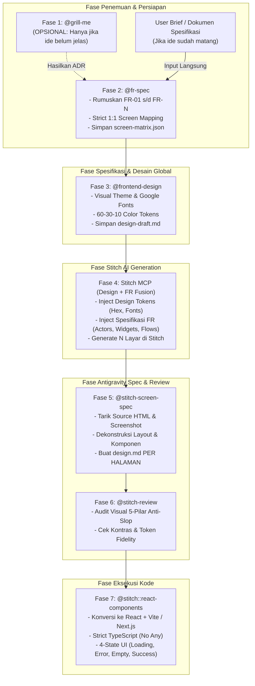

# Antigravity Agentic UI/UX & Engineering Pipeline

Repositori ini menggunakan arsitektur alur kerja agen terstruktur (*deterministic agentic workflow*) yang menghubungkan perumusan kebutuhan bisnis, pembuatan prototipe desain AI di **Google Stitch**, hingga konversi ke kode produksi **React + TypeScript** di **Antigravity IDE**.

Setiap langkah dalam siklus ini menghasilkan memori persisten di `.agents/memory/` sehingga seluruh proses dapat diaudit (*traceable*), deterministik, dan bebas dari halusinasi atau "AI Slop".

---

## 🚀 Alur Kerja Master (End-to-End Pipeline)



---

## 📖 Rincian 7 Fase Eksekusi

### Fase 1: Uji Kebutuhan & Arsitektur (`@grill-me`) — *OPSIONAL*
> [!NOTE]
> **Fase ini tidak wajib.** Gunakan hanya jika ide proyek masih abstrak, belum jelas, atau arsitekturnya belum teruji. Jika Anda sudah memiliki brief proyek atau PRD yang jelas, Anda bisa langsung memulai dari **Fase 2**.

- **Tujuan:** Menguji asumsi arsitektur melalui interogasi 3 ronde (skalabilitas, data flow, auth, edge cases).
- **Skill:** `@grill-me`
- **Output Memori:** `.agents/memory/grill-me/<project-slug>.md`

---

### Fase 2: Perumusan FR & Pemetaan Layar 1:1 (`@fr-spec`)
- **Tujuan:** Memecah cakupan sistem menjadi Functional Requirements (FR) atomik (`FR-01`, `FR-02`, ..., `FR-N`).
- **Aturan Deterministik:** **Jumlah halaman UI wajib persis sama dengan jumlah FR.** Jika terdapat 5 FR yang disepakati, sistem akan merencanakan tepat 5 layar UI di Stitch.
- **Skill:** `@fr-spec`
- **Output Memori:**
  - `.agents/memory/fr-spec/<project-slug>/fr-spec.md` (Dokumen FR lengkap & UI blueprint).
  - `.agents/memory/fr-spec/<project-slug>/screen-matrix.json` (Kontrak mesin untuk otomatisasi Stitch).

---

### Fase 3: Perumusan Desain Global Sementara (`@frontend-design`)
- **Tujuan:** Menetapkan arah estetika, sistem tipografi (Google Fonts), aturan border-radius, dan palet warna semantik (60% Canvas, 30% Surface, 10% Brand Accent).
- **Skill:** `@frontend-design` atau `@stitch-design-taste`
- **Output Memori:** `.agents/memory/frontend-design/<project-slug>/design-draft.md`

---

### Fase 4: Generasi Layar di Stitch (Design + FR Fusion)
> [!IMPORTANT]
> **Kunci Keselarasan Stitch:** Prompt generasi ke Stitch **DILARANG HANYA** menyertakan token warna/desain. Agen wajib menyuntikkan **gabungan antara token visual (`design-draft.md`) BERSAMA spesifikasi fungsional atomik (`fr-spec.md`)** ke dalam setiap prompt layar.

- **Proses:**
  1. `StitchMCP:create_project` (Inisialisasi project Stitch).
  2. `StitchMCP:upload_design_md` (Upload draft design tokens).
  3. `StitchMCP:generate_screen_from_text` untuk setiap screen di `screen-matrix.json`.
- **Skill Pendukung:** `@enhance-prompt` + Stitch MCP.
- **Output Memori:** `.agents/memory/stitch/<project-slug>/project-metadata.json` (Project ID, Screen IDs, URL aset).

---

### Fase 5: Ekstraksi Desain Per Halaman ke Antigravity (`@stitch-screen-spec`)
- **Tujuan:** Menarik hasil generasi Stitch kembali ke Antigravity IDE, mendownload source HTML dan visual screenshot, lalu mendekonstruksi setiap halaman menjadi spesifikasi teknis modular.
- **Skill:** `@stitch-screen-spec`
- **Output Memori:**
  - `.agents/memory/screens/<project-slug>/<screen-slug>/source.html` (HTML mentah dari Stitch).
  - `.agents/memory/screens/<project-slug>/<screen-slug>/design.md` (**Spesifikasi per halaman**, mencakup hierarki komponen atomik, micro-interactions, dan token Tailwind lokal).

---

### Fase 6: Audit Visual & Anti-AI Slop (`@stitch-review`)
- **Tujuan:** Memvalidasi setiap layar sebelum dikonversi ke kode produksi. Memastikan tidak ada gradasi klise (ungu-ke-pink rendahan), penempatan icon/panah tanpa fungsi, font acak, atau pelanggaran aksesibilitas (WCAG).
- **Skill:** `@stitch-review`
- **Output Memori:** `.agents/memory/stitch-review/<project-slug>/review-report.md`

---

### Fase 7: Konversi UI ke Kode Produksi React (`@stitch::react-components`)
- **Tujuan:** Menulis kode produksi React + TypeScript di `/src/` dengan merujuk langsung pada `design.md` per halaman dan template `source.html`.
- **Standar Kode (Sesuai `AGENTS.md`):**
  - Strict TypeScript (Dilarang menggunakan `any` atau `@ts-ignore`).
  - Maksimal 200–250 baris per file (pecah menjadi sub-komponen jika lebih).
  - Wajib menyediakan **4 State UI**: *Loading Skeleton*, *Error State*, *Empty State*, dan *Success State*.
  - Pemisahan data fetching ke *Custom Hooks* atau *Service Layer*.

---

## 📂 Struktur Memori Proyek (`.agents/memory/`)

Setiap tahapan menuliskan hasil kerjanya ke folder memori yang terstandarisasi:

```text
.agents/memory/
├── grill-me/
│   └── <project-slug>.md                    # ADR arsitektur (jika Fase 1 dijalankan)
│
├── fr-spec/
│   └── <project-slug>/
│       ├── fr-spec.md                       # Daftar FR & spesifikasi antarmuka
│       └── screen-matrix.json               # Matriks pemetaan 1 FR : 1 Screen
│
├── frontend-design/
│   └── <project-slug>/
│       └── design-draft.md                  # Token desain global & tema awal
│
├── stitch/
│   └── <project-slug>/
│       └── project-metadata.json            # ID Project & metadata layar dari Stitch
│
├── screens/
│   └── <project-slug>/
│       ├── screen-01-dashboard/
│       │   ├── source.html                  # Source code HTML dari Stitch
│       │   └── design.md                    # DESIGN SPEC KHUSUS HALAMAN 1
│       └── screen-02-management/
│           ├── source.html                  # Source code HTML dari Stitch
│           └── design.md                    # DESIGN SPEC KHUSUS HALAMAN 2
│
└── stitch-review/
    └── <project-slug>/
        └── review-report.md                 # Hasil audit kelayakan visual & anti-slop
```

---

## 💡 Panduan Memulai Cepat (Quick Start)

### Jalur A: Ide Belum Jelas (Mulai dari Grill-Me)
```markdown
1. "@grill-me Saya ingin membuat platform analitik portofolio multi-aset."
   -> Jawab interogasi 3 ronde sampai file ADR tersimpan di .agents/memory/grill-me/
2. "@fr-spec portfolio-app"
   -> Menghasilkan FR dan 1:1 Screen Matrix
3. "@frontend-design portfolio-app"
   -> Menghasilkan token visual awal di design-draft.md
4. "Lempar ke Stitch untuk generate screens"
   -> Agent memanggil Stitch MCP dengan menyuntikkan token + FR spec
5. "@stitch-screen-spec portfolio-app"
   -> Mengambil aset dan membuat design.md per halaman
6. "Lakukan eksekusi kode komponen React"
   -> Agent memproduksi kode produksi di /src/
```

### Jalur B: Ide / PRD Sudah Jelas (Langsung ke FR-Spec)
```markdown
1. "@fr-spec fintech-pos dengan brief: [tempelkan brief/fitur proyek Anda di sini]"
   -> Langsung membuat FR atomik dan 1:1 Screen Matrix tanpa sesi grill-me
2. Lanjutkan ke langkah 3 s/d 6 seperti biasa.
```

---

## 🛡️ Anti-AI Slop Guardrails
Pipeline ini dirancang untuk mencegah tampilan umum template AI murah:
- **Disiplin Font Tunggal:** Satu font family utama Sans-Serif (misal: *Plus Jakarta Sans* atau *Inter*) untuk konsistensi seluruh dashboard.
- **Hierarki Bobot & Spasi:** Pembedaan hierarki visual dilakukan lewat bobot (`font-medium` vs `font-bold`), kontras teks semantik, dan whitespace ritmis, bukan menambah font acak.
- **Aturan 60-30-10:** Mencegah tampilan UI yang terlalu ramai atau penuh gradasi neon yang menyakitkan mata.
